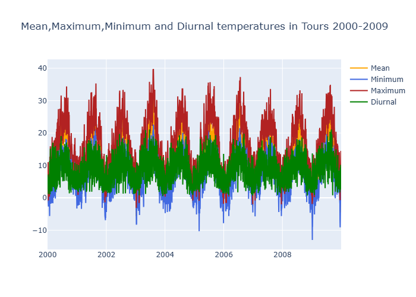
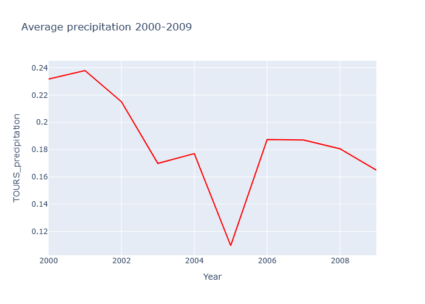
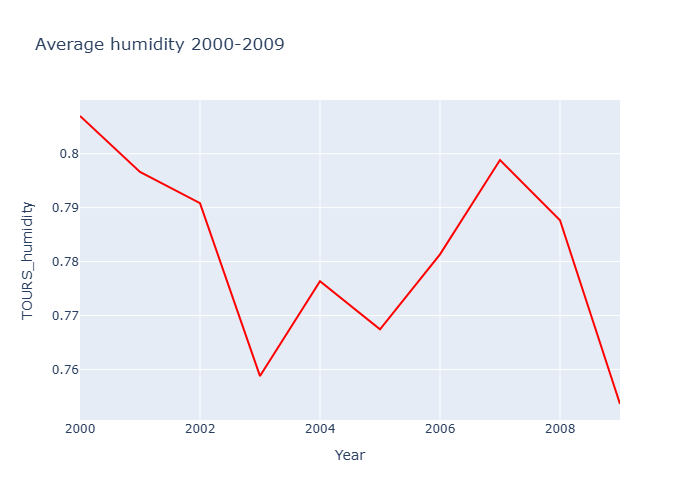
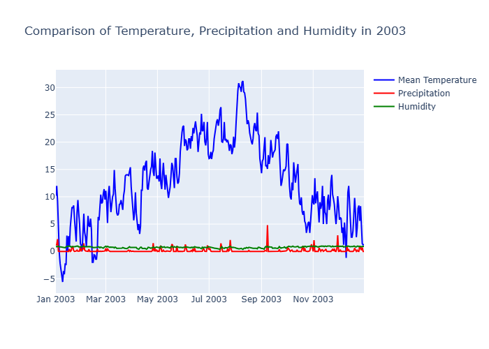
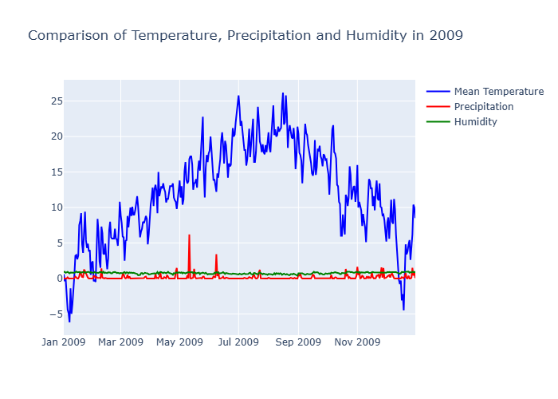
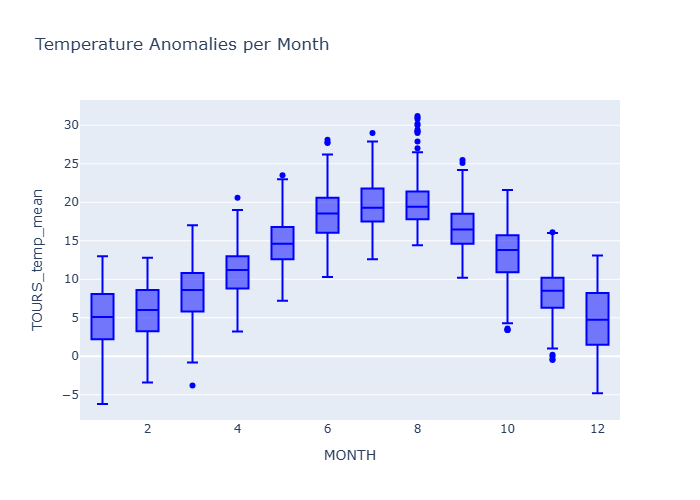
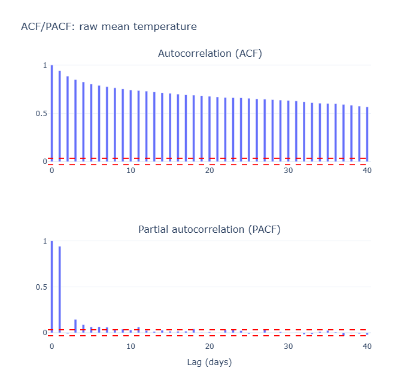
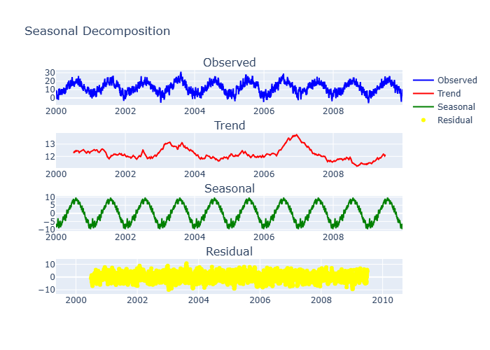
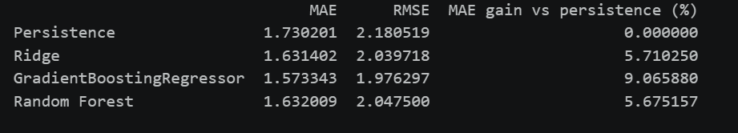

# Weather Prediction and Model Comparison

The project aims to understand weather patterns in the city of Tours during 2000-2009. Different machine learning models are used to predict temperature, and compare their performance. 

## Approach

** Exploratory Data Analysis

1. Observing the mean, maximum, minimum and diurnal temperatures. From the charts we can observe some significant peaks and dips that deviate from the normal trends.
   
   

2. Observing the average precipitation and humidity recorded from 2000-2009. Some years have below average precipitation, while some years proved to be more humid than others.
   
   

3. From the charts above, we observed some spikes in temperature in 2003 and some drops in 2009. So we individually analyse those years.
   
   

4. Observing the outliers.
   

5. Using autocorrelation to observe the temperature of day n on n-1, and performing seasonal decomposition.
   
   

** Modelling and Evaluation

To predict temperature, Ridge, GradientBoostingRegressor and Random Forest were used. The years 2000-2006 were set as training period and the years from 2007-2009 were used as test dataset. A baseline was established for further evaluation. MAE and RMSE were used as evaluation metrics, and it was observed that all 3 models performed better than the baseline, however GradientBoostingRegressor, turned out to be the best performing.

For better comprehension, user input was taken and the original temperature was compared with the returned prediction of each model.

   

   
   

